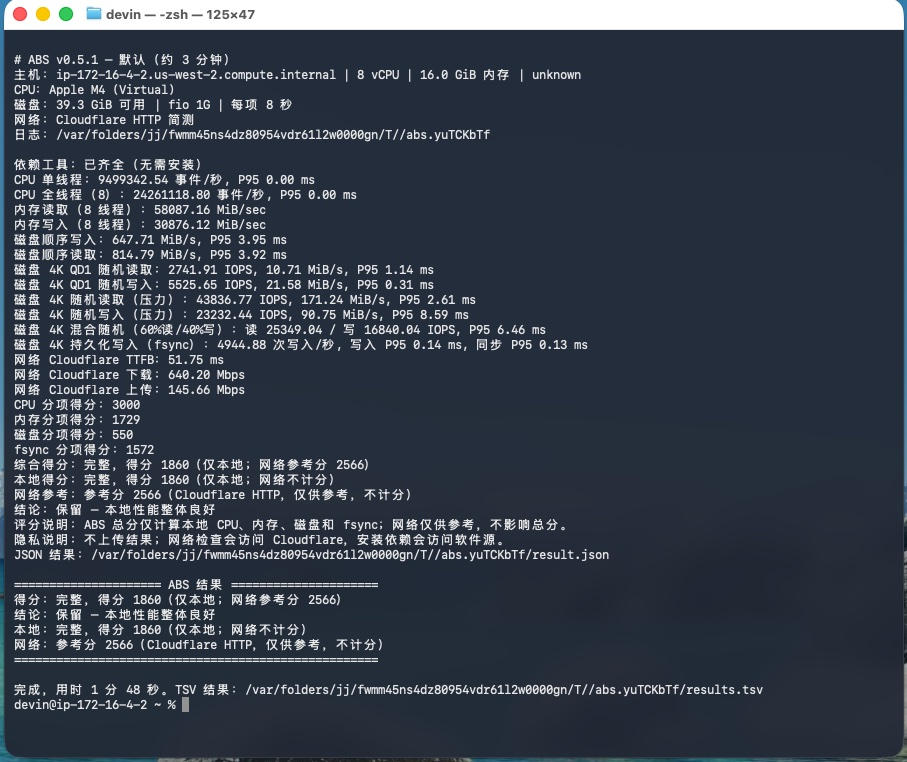

# ABS — AskClaw VPS Benchmark

[简体中文](README.md)

Run it on a Linux VPS before you rent or renew — it tells you whether the CPU is fast, the memory is adequate, and the disk can actually write. When it finishes you get a score plus one verdict: **KEEP / MAYBE / AVOID / INCOMPLETE**.

<p align="center"></p>

The image above is a real run: host details first, then the measured CPU/memory/disk/fsync numbers, then the final score and a `KEEP` verdict.

## Run

```bash
curl -fsSL https://askclaw.top/abs.sh | bash
```

Terminal output defaults to Chinese; a typical run finishes in about 3 minutes once dependencies are installed. ABS may install `sysbench`, `fio`, `python3`, and `curl` via `sudo`.

```bash
curl -fsSL https://askclaw.top/abs.sh | bash -s -- --lang en  # English output
curl -fsSL https://askclaw.top/abs.sh | bash -s -- -n         # don't install missing tools
curl -fsSL https://askclaw.top/abs.sh | bash -s -- --quick    # quick ~60s
curl -fsSL https://askclaw.top/abs.sh | bash -s -- --full     # full 5–8 min
curl -fsSL https://askclaw.top/abs.sh | bash -s -- --json-file result.json
curl -fsSL https://askclaw.top/abs.sh | bash -s -- --lang en --help  # every option
```

> `curl | bash` executes downloaded code. To inspect the script first:
>
> ```bash
> curl -fsSLo abs.sh https://askclaw.top/abs.sh && less abs.sh && bash abs.sh --lang en
> ```

## Reading the result

```text
SCORE   : FULL 1568 (local only; network reference 136)
VERDICT : MAYBE - disk component is weak (component score 306)
```

- **FULL** = every core test ran (doesn't mean fast)
- **PARTIAL — not comparable** = some test failed; don't compare this score to other machines
- **Verdict** = decided by local score + a weakest-component floor: any component below 250 forces `AVOID`; below 500 caps at `MAYBE`

## What it measures & how it scores

- **CPU** single-thread + all-thread throughput
- **Memory** sequential read + write
- **Disk** sequential, 4K random at QD1 (queue depth 1 — typical scattered small I/O), and multi-job pressure
- **fsync** durable 4K writes (what actually reaches disk, not just the memory cache)
- **Network** Cloudflare sanity (10 MB down, 5 MB up of zero data; **not scored**)

```text
score = 40% CPU + 15% memory + 30% 4K QD1 disk + 15% fsync
```

Formulas, reference constants, and known caveats live in [docs/scoring.md](docs/scoring.md).

## Comparing two VPSes — hard requirements

Two scores are directly comparable **only when all of these match**: ABS version, profile, `-t` threads, `-z` fio size, and `DIRECT` (default `1` = bypass the filesystem cache and measure real disk; `0` = through the cache, inflates numbers). Both runs must be `FULL`.

## Behavior notes

- **Install fails**: prints a reason + repair hint + log path, then keeps going and produces `INCOMPLETE` instead of silently dying. On interactive terminals `sudo` attaches to `/dev/tty`, so `curl | bash` can still prompt for a password; headless runs use non-interactive sudo and fail fast. ABS never runs `dpkg --configure -a` on its own.
- **Files**: logs land in a private `/tmp/abs.*` dir; the fio test file lives in its own temp dir and is removed after; existing `abs.test*` and `abs-dd.test` files are **never** deleted.
- **No fio**: falls back to a rough `dd` check, not scored.
- **Alpine minimal**: install bash first — `apk add bash`.
- **Language**: terminal output defaults to Chinese, `--lang en` or `ABS_LANG=en` switches; `results.tsv` and `result.json` stay in English for scripts.

**When GitHub Raw is unreachable from China**, use the jsDelivr mirror:

```bash
curl --resolve cdn.jsdelivr.net:443:104.16.175.226 \
  -fsSL https://cdn.jsdelivr.net/gh/getaskclaw/abs@main/abs.sh | bash -s -- -n
```

## License

MIT
